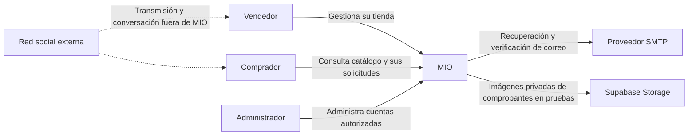
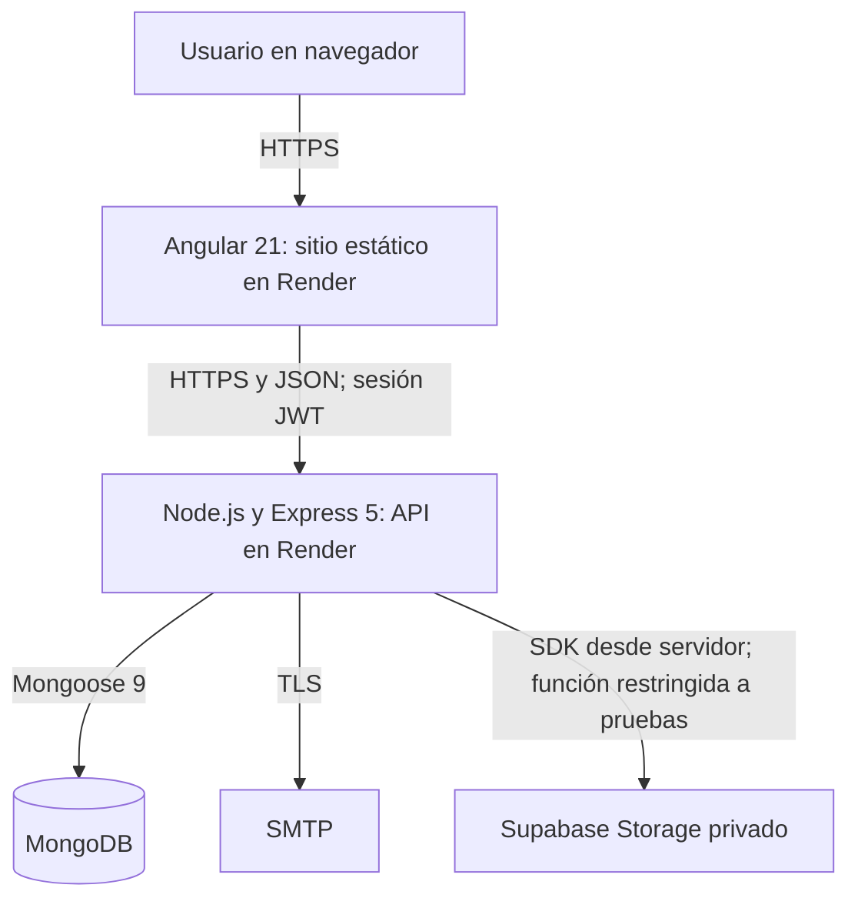

# Arquitectura de MIO

Revisión: 20 de noviembre de 2026. Describe la base `ea396b5` y el incremento local de programación de entregas; no certifica que cada función esté habilitada en producción.

## Contexto

MIO organiza clientes, piezas únicas, lives y pedidos de tiendas que venden por redes. La captura es manual: no transmite video, lee comentarios automáticamente ni procesa dinero.



El vendedor opera exclusivamente sus datos. El comprador consulta sus propias solicitudes; el administrador no recibe acceso general a comprobantes. Los permisos efectivos se validan en la API, no solo en las pantallas.

## Contenedores



La interfaz y la API se despliegan por separado. `backend/server.js` exige configuración privada y conecta MongoDB antes de escuchar; `backend/src/expressApp.js` monta rutas, CORS y errores. `PUBLIC_API_URL` configura la URL pública de la API al construir Angular. La conexión MongoDB, JWT, SMTP y credenciales de Storage permanecen en servidor. Las URLs firmadas para imágenes expiran a los 60 segundos.

## Las tres capas en este stack

| Capa | Archivos reales | Responsabilidad |
|---|---|---|
| Presentación | `frontend/src/app/pages/`, `shared/`, servicios HTTP; `backend/src/routes/`, `controllers/`, `middlewares/` | Mostrar, recoger datos, autenticar/autorizar peticiones y traducir HTTP a llamadas de servicio. |
| Negocio | `backend/src/services/pedidoService.js`, `solicitudApartadoService.js`, `comprobanteService.js`, políticas y demás servicios | Validar estados, propiedad, disponibilidad, plazos y casos de uso. |
| Datos e integraciones | `backend/src/repositories/`, `models/`, `config/db.js`; adaptadores SMTP y Storage | Consultar/persistir documentos y acceder a proveedores externos. |

Ejemplo: Pedidos → servicio HTTP Angular → ruta/controlador Express → `pedidoService` → `pedidoRepository` → MongoDB. Las comprobaciones de interfaz ayudan al usuario; la API debe repetir las validaciones que protegen datos.

**Límite actual:** no es una arquitectura limpia con inversión completa de dependencias. Algunos servicios importan Mongoose y otros adaptadores viven en `services/`. El negocio depende de detalles de infraestructura. La regla del módulo de dirigir dependencias hacia el negocio es una meta de mejora; no se declara cumplida completamente.

## Estructura actual de carpetas

```text
backend/
  server.js
  src/
    expressApp.js
    config/        # conexión y configuración
    routes/        # endpoints por recurso
    controllers/   # traducción HTTP
    middlewares/   # sesión, permisos y límites
    services/      # casos de uso, políticas y algunos adaptadores
    repositories/  # persistencia
    models/        # esquemas e índices
    scripts/       # administración y mantenimiento
  test/
frontend/src/app/
  pages/           # clientes, productos, pedidos, lives, perfil, etc.
  services/        # clientes HTTP
  shared/          # componentes reutilizables
docs/
  decisiones/
  bitacora/
```

Angular agrupa pantallas por funcionalidad; el backend conserva carpetas por tipo. No se renombraron masivamente como parte de esta entrega documental. Una evolución por funcionalidad puede introducir `modules/pedidos/{controller,service,repository}` en una tarea acotada con pruebas, manteniendo políticas comunes y sin modificar reglas incidentalmente.

## Límites operativos

- MongoDB no aporta claves foráneas automáticas; los servicios e índices protegen relaciones y duplicados.
- Los flujos transaccionales necesitan una topología compatible. La confirmación de reservas y las escrituras de comprobantes conservan restricciones de entorno de pruebas; su existencia en código no acredita producción.
- Render puede suspender la API por inactividad. No se debe depender de temporizadores en memoria para vencimientos; consultar `PUBLICACION.md` para el barrido externo pendiente.
- Las pruebas con repositorios o Storage simulados no sustituyen recorridos contra MongoDB y proveedores reales.

## Decisiones relacionadas

- [ADR 001: interfaz y API separadas](decisiones/001-interfaz-api-separadas.md).
- [ADR 002: imágenes privadas fuera de MongoDB](decisiones/002-comprobantes-privados.md).
- [ADR 003: programación, entrega y pago separados](decisiones/003-programacion-entregas.md).
