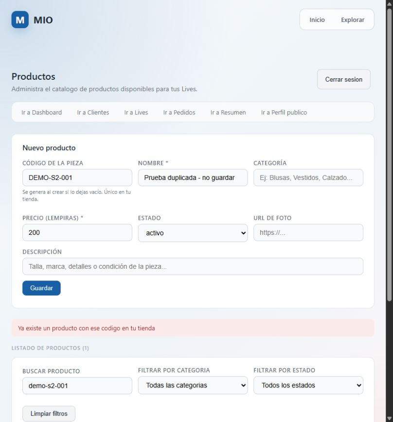
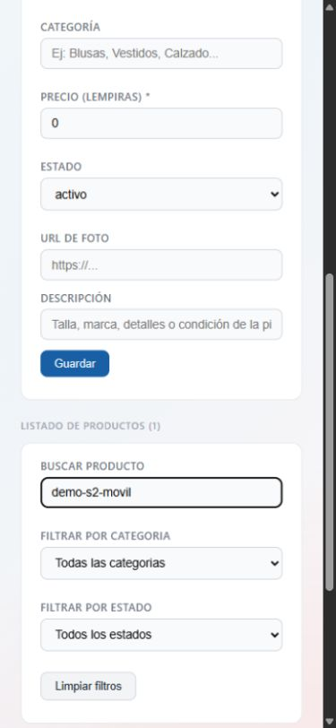

# HU-01: verificación en producción

Fecha: 1 de noviembre de 2026. Entorno: https://mio-web.onrender.com/productos, API pública HTTPS. Prueba observada por el asistente en navegador integrado, con sesión de vendedor iniciada por el responsable. No se registran credenciales ni datos personales.

Código de la funcionalidad: commit `313a363`, conservado en `67729ed`. El frontend publicado carga `main-HNRMTOXR.js`; `npm run build:deploy` sobre el código local con la API pública genera el mismo nombre de bundle. Esta coincidencia respalda la correspondencia del frontend; no identifica por sí sola el hash del despliegue del backend.

| Comprobación | Resultado observado |
|---|---|
| Crear pieza con código ` demo-s2-001 `, nombre ficticio y L200 | Guardada como `DEMO-S2-001` |
| Recargar `/productos` y buscar `demo-s2-001` | Una coincidencia: pieza de prueba por L200; persistencia y búsqueda confirmadas |
| Intentar otra pieza con `DEMO-S2-001` | Mensaje «Ya existe un producto con ese codigo en tu tienda»; sigue una sola coincidencia |
| Guardar código `BLUSA 01` | Rechazado con mensaje de formato |
| Guardar código de 31 letras A | Rechazado con mensaje de longitud/formato |
| Crear pieza dejando código vacío | Guardada con código generado `P-F0DD67F62DC0` |
| Vista de 390 × 844: crear `demo-s2-movil`, recargar y buscar | Guardada y encontrada como `DEMO-S2-MOVIL`, L150 |
| Reutilizar `DEMO-S2-001` con otro vendedor | Pendiente de segunda cuenta de prueba |

La prueba móvil utiliza un viewport de navegador, no un teléfono físico. El formulario se adapta a una columna y permite completar las acciones; el listado ancho requiere desplazamiento horizontal. Se restauró el tamaño del navegador al terminar.

## Capturas

Se crearon tres piezas ficticias en la primera tienda: `DEMO-S2-001`, `P-F0DD67F62DC0` y `DEMO-S2-MOVIL`. No se eliminaron datos ni se modificó la pieza preexistente. El rechazo de duplicados se comprobó contra la base real del despliegue; no se realizó auditoría global de índices, seguridad o concurrencia. HU-01 sigue abierta hasta completar el criterio entre tiendas y registrar el cierre.
