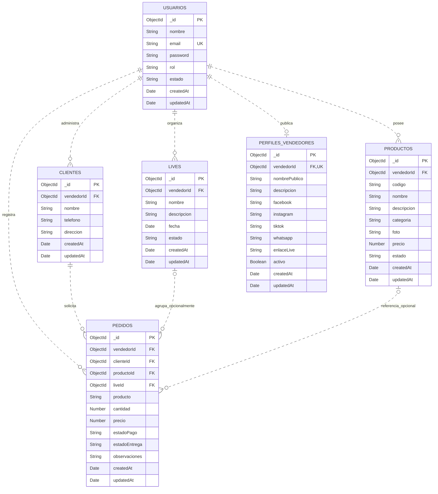
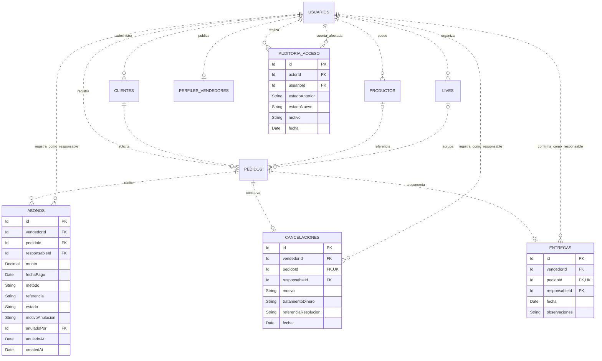

# Modelo de datos de MIO

Entrega del módulo 3, preparada el 1 de noviembre de 2026. Se documentan el modelo físico existente y el diseño del producto completo del plan de diez semanas. Fuente de verdad del estado implementado: `backend/src/models`, servicios y repositorios. Las funciones futuras se identifican como propuestas y no se presentan como desplegadas.

## 1. Del negocio a las entidades

Los sustantivos del mapa y backlog son usuario/vendedor, cliente, pieza, pedido, live, perfil, abono, cancelación, entrega e historial administrativo. Un vendedor es un usuario con rol `vendedor`; no existe una colección tiendas independiente. Un cliente del directorio no es necesariamente una cuenta de usuario. Categoría es hoy un atributo de producto. Resumen, dashboard, saldo y exportación son consultas o representaciones, no entidades persistidas independientes.

El modelo actual guarda documentos en seis colecciones MongoDB con Mongoose. `_id` identifica cada documento. Una referencia `ref` de Mongoose **no es una FOREIGN KEY impuesta por MongoDB**. Las marcas FK de los diagramas indican vínculos lógicos. `required`, `enum` y `min` son validaciones del ODM, no pruebas de que exista un validador de colección en el servidor. Los índices únicos declarados requieren existir realmente en la base.

## 2. Diagrama del modelo implementado

### Cardinalidades y límites

- **1:N:** un vendedor tiene cero o muchos clientes, piezas, lives y pedidos; cada documento pertenece a un vendedor. Un cliente tiene cero o muchos pedidos; cada pedido exige un cliente.
- **1:0..1:** un vendedor puede no haber creado todavía su perfil público; un perfil pertenece a un vendedor. El índice único sobre `vendedorId` limita a uno.
- Un pedido referencia cero o un live: la ausencia permite venta directa. Un live puede agrupar muchos pedidos.
- Un pedido referencia cero o una pieza: se conservan pedidos heredados o escritos como texto. El esquema permite muchas referencias al mismo producto; **no tiene un índice único de pedido por pieza**. La regla de negocio intenta permitir una sola reserva vigente, pero no está impuesta por una FK ni por el diagrama.
- **No existe N:M materializada actualmente.** No se inventa una tabla intermedia: cada pedido actual representa una línea de venta y el consolidado del cliente se obtiene consultando varias líneas. Si se introduce un pedido maestro con varias piezas, deberá añadirse un detalle de pedido y acordarse su migración.

## 3. Diccionario del modelo existente

Convenciones: **R** = requerido por Mongoose; **O** = opcional en el esquema. Un valor por defecto no equivale a `NOT NULL`: varios campos con default siguen siendo opcionales y pueden admitir `null`. Reglas de servicio adicionales se detallan después. Los nombres de colección son los físicos.

### Campos comunes a las seis colecciones

| Campo | Tipo | Regla y significado |
|---|---|---|
| `_id` | ObjectId | Identificador primario automático; índice único de MongoDB |
| `createdAt` | Date | Gestionado por `timestamps`; instante de creación |
| `updatedAt` | Date | Gestionado por `timestamps`; última actualización, no historial completo |
| `__v` | Number | Clave de versión interna de Mongoose; no es una bitácora ni garantiza por sí sola concurrencia de reservas |

### usuarios — identidad y acceso

Fuente: [users.js](../backend/src/models/users.js).

| Campo | Tipo | Obligatoriedad / restricciones | Significado |
|---|---|---|---|
| nombre | String | R; trim | Nombre del usuario |
| email | String | R; trim, minúsculas; índice único declarado | Correo de acceso; no hay validador de formato email en el esquema |
| password | String | R; `select:false`; excluido del JSON | Hash de contraseña, generado con bcrypt en el registro; nunca guardar contraseña en claro |
| rol | String | O; vendedor/admin/cliente; default vendedor | Rol de la cuenta; no es el cliente del directorio |
| estado | String | O; activo/inactivo; default activo | Habilitación de acceso |

### clientes — compradores registrados por una tienda

Fuente: [clientes.js](../backend/src/models/clientes.js).

| Campo | Tipo | Obligatoriedad / restricciones | Significado |
|---|---|---|---|
| vendedorId | ObjectId | R; ref User | Propietario del directorio |
| nombre | String | R; trim | Nombre del comprador |
| telefono | String | O; trim | Contacto; texto para conservar prefijos y ceros |
| direccion | String | O; trim | Dirección indicada a la tienda |

No hay unicidad declarada por nombre o teléfono; no asumir que dos compradores con igual nombre son la misma persona.

### productos — piezas del catálogo

Fuente: [productos.js](../backend/src/models/productos.js).

| Campo | Tipo | Obligatoriedad / restricciones | Significado |
|---|---|---|---|
| vendedorId | ObjectId | R; ref User | Tienda propietaria |
| codigo | String | O en esquema; trim, mayúsculas, máximo 30 | Identificación dentro de una tienda; servicio genera código si se omite |
| nombre | String | R; trim | Nombre de la pieza |
| descripcion | String | O; trim | Detalles de la pieza |
| categoria | String | O; trim | Clasificación textual actual |
| foto | String | O; trim | URL o referencia textual; el esquema no valida formato URL |
| precio | Number | R; mínimo 0 | Precio actual unitario del catálogo, en lempiras |
| estado | String | O; activo/inactivo/apartado; default activo | Disponibilidad de la pieza |

Índice declarado: **UNIQUE compuesto `(vendedorId, codigo)`**, parcial para documentos donde `codigo` es String. Permite igual código en tiendas distintas y documentos heredados sin código. HU-01 comprobó el rechazo de duplicados y reutilización entre dos tiendas en producción; eso no es una inspección de todos los índices del servidor.

### lives — eventos externos de venta

Fuente: [lives.js](../backend/src/models/lives.js).

| Campo | Tipo | Obligatoriedad / restricciones | Significado |
|---|---|---|---|
| vendedorId | ObjectId | R; ref User | Organizador |
| nombre | String | R; trim | Nombre del evento |
| descripcion | String | O; trim | Descripción |
| fecha | Date | O en esquema | Instante previsto del evento |
| estado | String | O; programado/activo/pausado/finalizado/cancelado; default programado | Ciclo del evento |

MIO no almacena ni transmite el video. El enlace del live se guarda actualmente en el perfil del vendedor, no en cada documento live.

### pedidos — línea de venta o apartado

Fuente: [pedidos.js](../backend/src/models/pedidos.js).

| Campo | Tipo | Obligatoriedad / restricciones | Significado |
|---|---|---|---|
| vendedorId | ObjectId | R; ref User | Tienda que registra |
| clienteId | ObjectId | R; ref Cliente | Comprador asociado |
| productoId | ObjectId | O; ref Producto | Pieza del catálogo, si existe vínculo |
| liveId | ObjectId | O; ref Live | Evento opcional; ausencia o null representa venta directa |
| producto | String | R; trim | Nombre histórico de la pieza; admite ventas heredadas en texto |
| cantidad | Number | O; default 1; mínimo 1 | Cantidad; servicio exige 1 si hay productoId |
| precio | Number | R; mínimo 0 | Precio unitario acordado del pedido; no se actualiza desde el catálogo |
| estadoPago | String | O; pendiente/pagado; default pendiente | Confirmación manual de pago total, sin abonos |
| estadoEntrega | String | O; pendiente/entregado; default pendiente | Confirmación manual de entrega |
| observaciones | String | O; trim | Anotaciones |

El esquema no exige cantidad entera para pedidos heredados sin pieza; es una brecha por resolver, no una restricción implementada. Total de una línea = cantidad × precio. El servicio permite editar el precio del pedido: conservar precio histórico frente a cambios del catálogo no equivale a bloquear toda edición autorizada del pedido.

### perfiles_vendedores — presencia pública opcional

Fuente: [perfilVendedor.js](../backend/src/models/perfilVendedor.js).

| Campo | Tipo | Obligatoriedad / restricciones | Significado |
|---|---|---|---|
| vendedorId | ObjectId | R; ref User; índice único declarado | Propietario, máximo un perfil por vendedor |
| nombrePublico | String | O; trim | Nombre comercial visible |
| descripcion | String | O; trim | Presentación de la tienda |
| facebook | String | O; trim | Referencia social |
| instagram | String | O; trim | Referencia social |
| tiktok | String | O; trim | Referencia social |
| whatsapp | String | O; trim | Contacto público que la tienda decida publicar |
| enlaceLive | String | O; trim | Enlace externo del evento |
| activo | Boolean | O; default true | Visibilidad/habilitación |

Los enlaces no tienen un validador URL en este esquema. El servicio crea el perfil al solicitarlo si no existe y guarda textos vacíos como valores válidos.

## 4. Integridad y comportamiento al borrar

| Regla | Dónde existe hoy | Qué falta / límite |
|---|---|---|
| PK por documento | `_id`, MongoDB | No confundirlo con unicidad del código comercial |
| Email único | Índice declarado en User | Confirmar índice real en cada entorno; normalizar antes de comparar |
| Código único por tienda | Índice compuesto parcial | No garantiza reserva única de pieza por pedido |
| Campos obligatorios, estados y mínimos | Mongoose; servicios; formularios | No se encontró migración que instale validadores de colección; escritura directa puede eludir el ODM |
| Cliente/pieza/live de la misma tienda | Consultas de pedidoService filtradas por vendedorId | No hay FK en MongoDB; hay ventanas de concurrencia entre comprobación y escritura |
| Borrar cliente, producto o live con pedidos | Servicio rechaza con conflicto; live activo también protegido | No es `ON DELETE RESTRICT` del motor; comprobar y borrar son operaciones separadas |
| Borrar vendedor con datos | Servicio consulta pedidos/productos/clientes/lives y rechaza; protege autogestión del admin | No es una FK ni auditoría exhaustiva de referencias |
| Perfil al borrar usuario permitido | Servicio elimina perfil por vendedor | Cascada manual, no automática del motor |
| Borrar pedido | Borrado físico y posterior intento de liberar pieza | No conserva historial de cancelación; no hay una transacción completa |
| Apartar pieza y crear pedido | Actualización condicional activo→apartado y escritura de pedido; compensación al fallar | Dos escrituras; fallo del proceso o de compensación puede dejar inconsistencia |

Los repositorios incluyen retornos alternativos cuando no existe conexión. No deben interpretarse como una comprobación de integridad real ni una estrategia suficiente de tolerancia a fallos. Las pruebas actuales con mocks no certifican concurrencia o integridad del servidor.

## 5. Producto completo — ampliación propuesta

El producto completo conserva las seis entidades anteriores y añade cuatro para HU-12 a HU-16 y HU-18. **Este diagrama es diseño futuro**, no colecciones creadas ni migración ejecutada. Mantiene un pedido por línea de venta; el consolidado por cliente es una consulta. Las relaciones se proponen con aislamiento por vendedor también en los vínculos.

`Id` es un identificador conceptual: ObjectId si se continúa en MongoDB o un identificador acordado al migrar. Las referencias al responsable y anuladoPor también apuntan a usuarios; la relación anuladoPor se omite visualmente para no superponer líneas. No se introducen listas separadas por comas ni tablas de reportes.

### Diccionario y restricciones propuestas

| Entidad | Campos y tipos | Reglas propuestas | Borrado propuesto |
|---|---|---|---|
| abonos | id PK; vendedorId, pedidoId, responsableId referencias obligatorias; monto Decimal obligatorio; fechaPago Date obligatoria; metodo String obligatorio; referencia String opcional; estado vigente/anulado obligatorio; createdAt Date obligatorio | monto > 0; suma de abonos vigentes ≤ importe pedido, comprobada con control transaccional; anulación exige motivoAnulacion String, anuladoPor referencia y anuladoAt Date. No cambiar monto histórico: anular y registrar corrección | Restringir borrado de pedido y usuarios referenciados; conservar abonos; no eliminar físicamente movimientos |
| cancelaciones | id PK; vendedorId, pedidoId, responsableId referencias obligatorias; motivo String obligatorio; tratamientoDinero String obligatorio; referenciaResolucion String opcional; fecha Date obligatoria | UNIQUE pedidoId; no cancelar dos veces; con abonos exigir resolución validada por tienda, sin borrar dinero; confirmar cancelación y liberación en una operación consistente | No borrar pedido ni cancelación; conservar historial. Política de devolución o crédito pendiente de acuerdo, no se inventa |
| entregas | id PK; vendedorId, pedidoId, responsableId referencias obligatorias; fecha Date obligatoria; observaciones String opcional | UNIQUE pedidoId; pedido no cancelado y saldo cero como regla provisional; no habilitar excepción hasta acordarla | Conservar registro; corrección futura mediante evento trazable, no borrado |
| auditoria_acceso | id PK; actorId y usuarioId referencias obligatorias; estadoAnterior y estadoNuevo activo/inactivo obligatorios; motivo String obligatorio; fecha Date obligatoria | Registro inmutable; actor administrador autorizado; estados distintos; sin datos sensibles innecesarios | Restringir eliminación de usuarios referenciados y preservar eventos; preferir desactivar cuentas |

Extensiones propuestas a pedidos: `estadoPedido` (activo/cancelado, requerido con default activo) y representación exacta del dinero. Si estadoPago/estadoEntrega se mantienen por compatibilidad, deberán derivarse o sincronizarse transaccionalmente con movimientos, no editarse como verdades financieras independientes. Convertir pagos totales previos en movimientos exige una migración explícita y revisión: no inventar fechas ni comprobantes históricos.

Para SQL, las referencias deberían ser FOREIGN KEY con RESTRICT para datos operativos/financieros; vínculos de tienda mediante claves compuestas `(vendedorId, id)` cuando corresponda. Para MongoDB, requerir validadores de colección para tipos/valores y controles transaccionales para existencia, pertenencia y sumas: un validador por documento no reemplaza una FK entre colecciones. Estas medidas están propuestas, no verificadas como implementadas.

## 6. Normalización, dinero y fechas

El nombre del cliente vive en clientes; pedido usa clienteId. El nombre de la pieza y su precio en pedidos son una **instantánea histórica consciente**: modificar el catálogo no debe alterar lo acordado. No se almacenan totales o saldos manuales: el resumen actual calcula cantidad × precio y agrupa por estados; el futuro saldo será importe menos abonos vigentes con el tratamiento de cancelación acordado.

**Brecha monetaria actual:** precio es Number y se calcula con JavaScript Number. No es un decimal exacto; no se presenta como adecuado para contabilidad. Antes de HU-12, elegir Decimal128 con aritmética decimal si se mantiene MongoDB, o NUMERIC/DECIMAL al migrar; otra alternativa explícita es enteros de centavos con límites seguros. Definir redondeo a dos decimales, migrar datos revisados y evitar reconvertir a flotante para sumar.

Los campos Date representan instantes. La zona de negocio es America/Tegucigalpa: transmitir fechas con offset o UTC y convertir al presentar. Los modelos no guardan una zona de tienda independiente; no afirmar soporte multizona completo. Las fechas obligatorias del diseño futuro no significan que `lives.fecha` ya sea required en el esquema actual.

## 7. Migraciones y datos de prueba

No se encontró un historial de migraciones del esquema ni un seed versionado de negocio. Mongoose contiene definiciones e índices, pero eso no acredita cambios históricos reproducibles ni validadores instalados en producción. No se ejecutó migración, borrado ni cambio de motor para esta entrega.

Procedimiento propuesto antes del siguiente cambio persistente: crear archivo numerado y registro de versión aplicada; probar en una base de desarrollo vacía y en una copia anonimizada; separar estructura de seed ficticio; revisar respaldo y restauración; aplicar en orden con precondiciones y verificar el resultado; no reescribir migraciones ya aplicadas. Una reversión que borre datos no sustituye un respaldo. Revisar huérfanos y duplicados antes de añadir restricciones.

Datos ficticios reproducibles para pruebas: vendedor A y B; cliente de A; pieza A `M3-PIEZA-001`, L300; código igual permitido en B; segunda pieza de A para comprobar independencia. Pruebas: guardar y recargar; pedido directo asociado al cliente; pieza pasa a apartado; pago y entrega conservados; resumen L300; duplicado de código rechazado en A; referencia a cliente ajeno rechazada; segundo apartado y fallos concurrentes probados por separado. No incluir correos reales, tokens, contraseñas ni datos de clientes en el repositorio.

## 8. Decisión de persistencia y validación

Se conserva MongoDB para esta entrega, por continuidad del prototipo y evidencia existente. PostgreSQL sigue siendo una opción a evaluar antes de la parte financiera; no hay una migración autorizada ni implementada. El modelo completo hace explícitas las reglas necesarias para decidir con fundamento. La simple cantidad de entidades no decide el motor.

Flujo central comprobado en producción el 1 de noviembre: cliente ficticio + pieza `M3-PIEZA-001`, L300 → pedido directo → consulta tras recarga → confirmación manual ficticia de pago/entrega → resumen con un pedido, L300 vendido/pagado, L0 pendiente y una entrega. La pieza ya no apareció en el selector de activas después de recargar pedidos. [Bitácora de semana 3](bitacora/semana-3.md). No se enviaron pagos reales ni se probó concurrencia en este recorrido.
